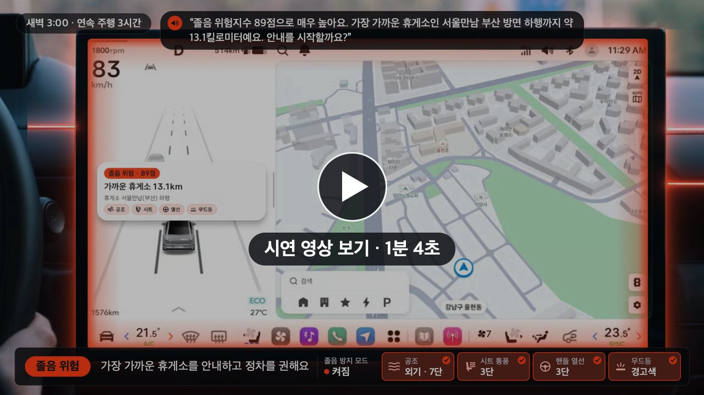
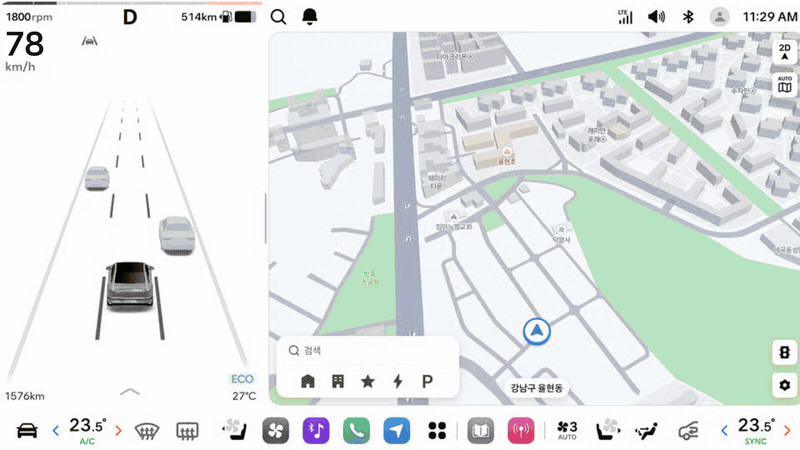
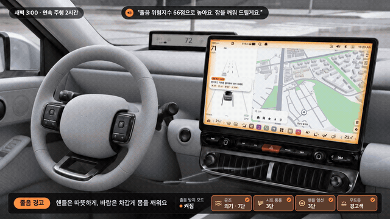
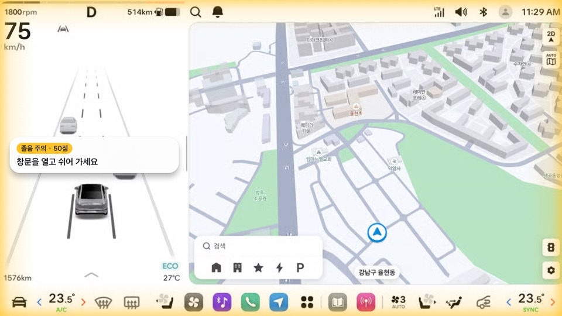
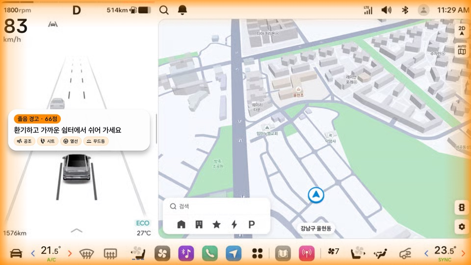
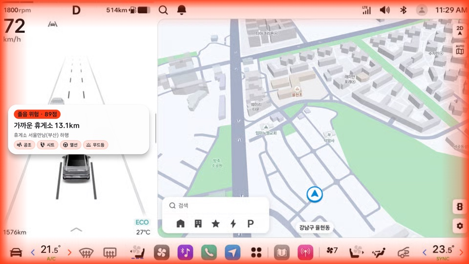

# 깨워드림 WakeMate

졸음은 스스로 알아차리기 어렵습니다. 깨워드림은 차량 신호로 졸음 위험을 추정해 단계별로 알려 주고, 경고 단계에서는 공조·시트 통풍·핸들 열선·무드등으로 몸을 깨우며, 위험 단계에서는 가까운 졸음쉼터·휴게소로 안내합니다. 위험지수는 차량 신호 기반 추정이며 직접 측정이 아닙니다.

[](docs/video/wakemate-demo.mp4)



정상 → 주의 → 경고 → 위험으로 바뀌는 실제 앱 화면입니다(에뮬레이터 녹화). Pleos 기본 화면은 그대로 두고, 화면 가장자리 빛과 주행 섹션 위 경고 카드로 단계를 알립니다.

## 기능
- **졸음 위험지수(0~100)**: 시간대, 연속 주행, 조향 패턴, 속도 변동성, 내기순환 지속을 합쳐 주의/경고/위험 단계로 나눕니다.
- **단계별 깨우기**
  - 주의: 음성으로 휴식을 권하고, 공조 제어가 켜져 있으면 외기 전환을 한 번 제안합니다.
  - 경고: 경고음과 함께 **졸음 방지 모드**를 켭니다. 외기 순환·풍량·온도, 운전석 시트 통풍, 핸들 열선, 실내 무드등 경고색을 한 번에 바꾸고, 음성은 "졸음 방지 모드를 시작했어요" 한 문장으로 알립니다. 차량이 지원하는 장치만 쓰고, 바꾸지 못한 장치는 이유를 말하며, 휴식 뒤에는 원래 값으로 되돌립니다.
  - 위험: 같은 물리 자극과 함께 가장 가까운 졸음쉼터·휴게소를 안내하고, 수락하면 내비에 경로를 요청합니다.
  - 주행 중에는 음성·경고음으로만 알리고 화면 조작을 요구하지 않습니다.
- **단계별 화면**: 화면 가장자리(베젤)부터 단계 색(노랑·주황·빨강) 빛이 번지고, 반투명 경고 카드에 단계·점수, 위험 단계의 가까운 쉼터, 차량이 작동을 확인한 장치(공조·시트·열선·무드등 또는 경고음)만 아이콘 칩으로 보여 줍니다.
- **백그라운드 감시**: 설정 스위치(기본 꺼짐)로 켜며 알림 권한이 필요합니다. 켜면 화면 밖에서도 차량 신호만 읽고 위치는 수집하지 않습니다.



경고 단계의 졸음 방지 모드 연출입니다. 핸들 열선이 켜지고 송풍구에서 찬바람이 나오며, 하단 상태가 "켜짐"으로 바뀌고 작동한 장치에 체크가 붙습니다(실내 장면은 합성).

| 주의 | 경고 | 위험 |
|---|---|---|
|  |  |  |
| 노란 가장자리 빛, 휴식 권유 | 주황 빛, 졸음 방지 모드 장치 칩 | 빨간 빛, 가까운 휴게소 거리 |

## 실행 방법
```
adb install -r apk/hmg-car-app-team_WakeMate_release.apk
adb shell am start -n com.hmgcarapp.wakemate/.MainActivity
```
이전 빌드가 설치되어 있어 서명이 달라 설치가 거부되면 `adb uninstall com.hmgcarapp.wakemate` 후 다시 설치하세요.

## 시연(debug 빌드)
```bash
cd app && ./gradlew :wake-mate:installDebug
```
앱 목록의 **깨워드림 시연**을 열면 Pleos 홈 화면 이미지를 배경으로 앱의 실제 컴포넌트(가장자리 빛·경고 카드)가 얹히고, 약 2분 30초 동안 주의 → 경고 → 위험으로 진행합니다. Pleos 차량 서비스가 없는 에뮬레이터에서도 가상 차량이 공조·시트 통풍·핸들 열선·무드등 쓰기를 받아 주므로 차속·운전석 온도·풍량·시트 통풍 단계가 화면에서 실제로 바뀝니다. 가상 차량은 debug 빌드에서 시연 화면이나 adb(`--ez vcar true`)로 켤 때만 쓰이고, release 빌드는 실제 차량 SDK만 씁니다. 캡처는 `docs/screens/pleos-demo-*.png` 에 있습니다.

## 시연 영상
[`docs/video/wakemate-demo.mp4`](docs/video/wakemate-demo.mp4) (1분 4초, 1080p, 소리 포함). 위 시연 화면을 에뮬레이터에서 녹화해 실내 사진의 디스플레이에 넣고, 단계에 맞춰 실내 무드등·화면 둘레 빛·핸들 열선·송풍구 찬바람을 합성했습니다. 음성은 앱의 안내 문구를 AI 음성 합성(Higgsfield의 Inworld Text to Speech, 한국어 음성 Minji)으로 만들어 위쪽 자막과 같은 시각에 넣었고, 경고음은 앱의 경고음 패턴을 재현했습니다. 경고 단계의 물리 자극은 음성으로 "졸음 방지 모드를 시작했어요" 한 번만 알리고, 어떤 장치가 켜졌는지는 화면(앱 경고 카드의 장치 칩, 영상 하단의 졸음 방지 모드 상태)으로 보여 줍니다. 앱 화면은 실제 동작 녹화이고 실내 장면은 연출입니다. 렌더러와 장면 목록은 `docs/video/render/` 에 있습니다.

## 테스트 환경
- Pleos Connect v2.1.0 에뮬레이터(AVD 이름 pleos21), Android 14, 2560x1440 가로
- 화면 캡처·시연 영상: Android Automotive API 34 표준 에뮬레이터(2560x1440, 160dpi). Pleos 차량 서비스가 없어 실제 장치 쓰기 대신 debug 빌드의 가상 차량을 썼습니다.
- APK 위치: `apk/hmg-car-app-team_WakeMate_release.apk` (release, 버전 0.1.0)

## 데이터 출처
- 한국도로공사 졸음쉼터(공공데이터포털 15028203), 휴게소정보(15025446). 수집일 2026-11-11, 열 이름 정규화·중복 제거 등 가공.
- 이용허락범위는 공공데이터포털 안내에 따르며, 스냅샷이며 실시간 정보가 아니므로 현재 운영 상태를 보증하지 않습니다.

## 개인정보
위치는 가까운 졸음쉼터 계산에만 메모리에서 쓰고 저장하지 않습니다. 설정·개인 보정값·휴식 기록은 기기 안에만 저장하며 서버로 보내지 않습니다.

## 소스 빌드·테스트
`app/` 폴더만으로 단독 빌드됩니다(JDK 17, Android SDK 필요, Pleos SDK 는 공개 Maven 에서 받으므로 인터넷 필요).

```bash
cd app
./gradlew :wake-mate:assembleDebug :wake-mate:assembleRelease
./gradlew :core:test :wake-mate:testDebugUnitTest
```

서드파티 고지는 `app/NOTICE`, 폰트 라이선스는 `app/licenses/` 에 있습니다.
